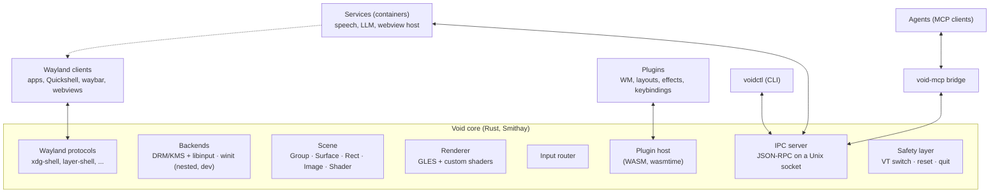
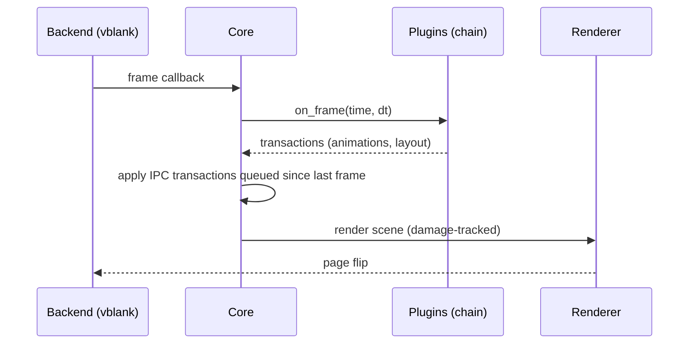

# Architecture

!!! note "Draft"
    This is the first cut of the architecture. Component boundaries are
    deliberate; the choice of libraries is subject to the review in
    [Alternatives](alternatives.md).

## Overview

The core has exactly one internal language: **scene commands** and **events**.
In-process plugins and out-of-process IPC clients both use it; the MCP bridge
translates it into MCP tools. Nothing outside the core can touch scene state
any other way.

## Components

### Core

The compositor binary `void`. Responsibilities, and nothing more:

- Wayland protocol handling and client lifecycle (via Smithay).
- Backends: DRM/KMS + libinput on real hardware (via a session such as
  libseat), a winit window for development inside another compositor.
- Owning the **scene** and rendering it every frame.
- Routing input (see below).
- Hosting plugins and running the IPC server.
- The **safety layer**: hardcoded, non-overridable bindings for VT switching,
  quitting, and an emergency reset that unloads all plugins and loads a
  configured safe view.

### Scene

A tree of nodes with stable ids. Every node has:

- `transform` (position, scale, rotation, anchor), `opacity`, `visible`, `z`
- optional `clip` (rect, rounded)
- optional `effects` (a chain of shader effects with uniforms)
- `input` behaviour (receives input, passes through, or blocks)
- free-form `meta` (key/value) that plugins and agents use to tag and find nodes

Node kinds: **Group**, **Surface**, **Rect**, **Image**, **Shader** (see
[Glossary](glossary.md)). New Wayland toplevels and layer surfaces are
**not** placed automatically: the core creates a detached surface node and
emits `surface.created`; a plugin decides where — or whether — it appears.

The scene crate has no Smithay dependency, so it can be tested and used by
tools (e.g. view validation) without a running compositor.

### Renderer

Smithay's GLES renderer with custom pixel and texture shaders, which covers
blur, rounded corners, shadows, color effects and transitions (niri and
Hyprland show what this can do). The renderer sits behind a narrow interface
so a wgpu or Vulkan renderer can replace it later. Shaders are GLSL ES,
compiled at runtime, hot-reloadable; a compile error keeps the previous shader.

### Plugin host

Loads sandboxed WASM plugins on wasmtime — Component Model (WIT) for core
plugins, possibly Extism or a script runtime for quick snippets (see
[Decisions](decisions.md), P1). A plugin:

- receives events (input, surface lifecycle, timers, frame ticks)
- returns or submits scene commands as transactions
- can be loaded, reloaded and unloaded at runtime
- runs under a time budget per call; a plugin that traps, panics or exceeds its
  budget is unloaded and its last transaction rolled back

Plugins are ordered in a **chain**. Each event passes through the chain; a
plugin may consume it.

### IPC server

JSON-RPC 2.0 over a Unix socket at `$XDG_RUNTIME_DIR/void/void.sock`.
Clients authenticate with a token that carries their [capabilities](api.md#capabilities).
Used by `voidctl`, services and the MCP bridge. Event subscriptions are
streamed over the same connection.

### MCP bridge

A separate small process (`void-mcp`) that exposes the IPC API as MCP tools
and resources. Keeping MCP out of the core keeps the core lean and lets the
MCP side evolve (transports, tool design) without touching the compositor.

## Frame flow

Transactions from IPC clients are applied at frame boundaries, so an agent
never sees or causes a half-applied state.

## Input flow

1. libinput event arrives in the core.
2. The **safety layer** checks its hardcoded bindings first.
3. The event passes through the plugin chain; a plugin may consume it
   (keybinding), transform it, or let it pass.
4. Unconsumed events go to the **focused** surface. Focus is just state in the
   scene; plugins set it. Pointer events go to the topmost input-accepting
   node under the cursor, with transforms inverted.

The core never decides focus on its own.

## Safety and robustness

- A plugin failure never takes down the compositor: traps are caught, the
  plugin is unloaded, its transaction rolled back, an event is emitted.
- Every applied transaction can be undone; the core keeps a short history.
- The emergency reset is a hardcoded key combination that restores a
  configured safe view (default: all surfaces in a simple grid, no effects).
- Capabilities restrict what each IPC client and plugin may do; input
  injection and screen capture are separate, explicit grants.

## Deployment

- Built as a binary plus a `void.desktop` Wayland session file, so a display
  manager offers Void next to the existing desktops.
- Packaged into a derived secureblue image built with the existing image
  tooling (`secureblue-images`, `image-builder-action`).
- Xwayland via `xwayland-satellite` (a separate process), not in the core.
- Services run as Podman containers (e.g. Quadlet units) or distrobox
  containers and connect via the IPC socket or as ordinary Wayland clients.
