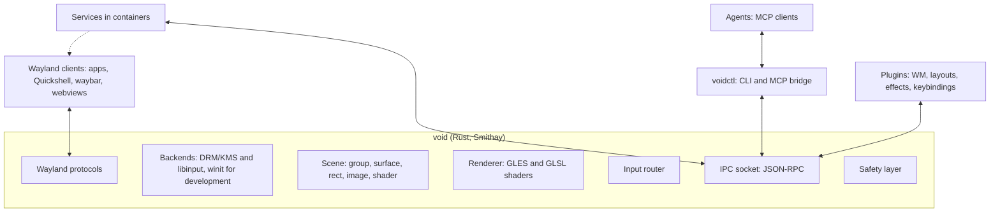
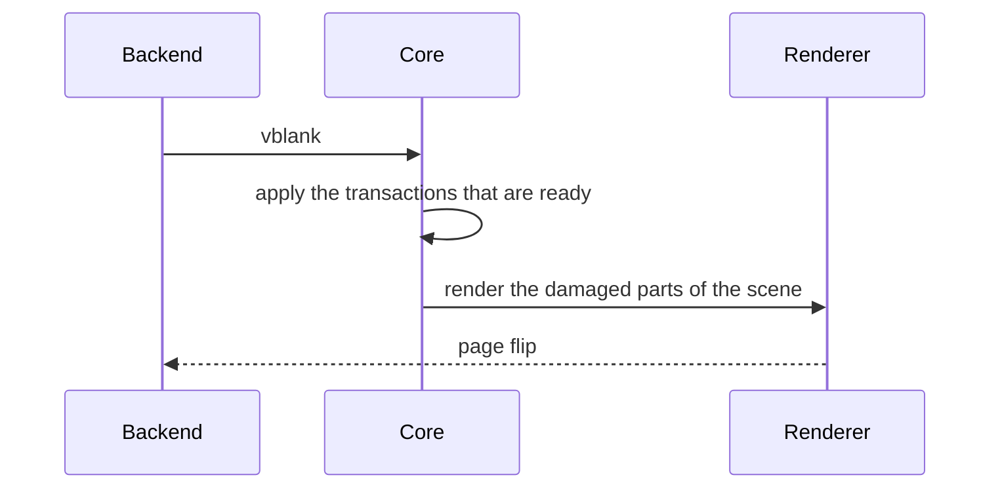

# Architecture

!!! note "Draft"
    This page shows the architecture after the first review. The proposals
    (P and R) in [Decisions](decisions.md) can still change it. The page names
    them where they apply.

## Overview

The core has one language: **commands** and **events** (see [API](api.md)).
Plugins, `voidctl`, services and agents all use it. Nothing outside the core
changes the scene in another way.

The diagram shows plugins as IPC clients, as proposal R1 suggests. Decision D7
adds in-process plugins for work in every frame. R1 defers them.

## Components

### Core

The compositor binary `void`. Its tasks, and nothing more:

- Wayland protocol handling and the client lifecycle, through Smithay.
- Backends: DRM/KMS and libinput on real hardware, through libseat. A winit
  window for development inside another compositor.
- The scene, rendered every frame.
- Input routing (see below).
- The IPC socket.
- The safety layer (see below).

The core places popups, subsurfaces and layer surfaces itself, because the
protocols define their position. Smithay's `PopupManager` and `LayerMap` do
this work. Only toplevels wait for a plugin: the core creates a detached
surface node and sends `surface.created`. A plugin decides where the surface
appears, or if it appears at all.

### Scene

The scene is a tree of nodes with stable ids. [API](api.md#nodes) lists the
node properties. The order of the children sets the stacking order.

The crate `void-scene` holds the scene model (see
[Project structure](project-structure.md)).

### Renderer

The core uses Smithay's GLES renderer through Smithay's own renderer traits
(P3).
Custom texture and pixel shaders give blur, rounded corners, shadows, color
effects and transitions. niri shows what this approach can do. Shaders are
GLSL ES. The core compiles them at runtime and reloads them when they change.

Damage tracking keeps the GPU load low. Each shader declares if it is static
or animated, and effects expand the damage area. A fullscreen surface without
effects goes to direct scanout.

### IPC socket

JSON-RPC 2.0 on a Unix socket. The core exports its path as `VOID_SOCKET`.
`voidctl`, plugins and services connect to it. Event subscriptions stream over
the same connection.

### voidctl and the MCP bridge

`voidctl` is the CLI for the coordinator. `voidctl mcp` serves the API as MCP
tools over stdio. MCP stays out of the core (P2), so the MCP side can change
without a change to the compositor.

## Transactions

A transaction is a batch of commands. The core applies it as one unit.

Some commands need a client round trip. A resize sends a configure event, and
the client must answer with a new buffer. The core therefore holds the
transaction until all affected clients commit, or until a deadline passes.
Then the core shows all changes in the same frame. Sway, niri and River work
the same way.

## Frame flow

## Input flow

1. libinput sends an event to the core.
2. The safety layer checks its fixed bindings first.
3. The plugins that grabbed the key or the pointer get the event. A plugin
   consumes the event or lets it pass.
4. The focused surface gets each event that no plugin consumed. Pointer
   events go to the topmost node under the cursor that accepts input.

Focus is state in the scene, and plugins set it. The core never sets focus by
itself. The core still implements the protocol mechanisms around focus:
popup grabs, `xdg-activation` requests, `pointer-constraints` and
`input-method`.

## Safety layer

The safety layer is the only built-in behavior (see
[Vision](vision.md#principles)). No plugin and no IPC client can change it.

- **Fixed bindings** for VT switch, quit and emergency reset. Injected input
  never triggers them.
- **Emergency reset.** The core unloads all plugins, removes all effects and
  puts all surfaces in a simple grid. This grid is the one layout in the core.
  It is hardcoded, so a broken config cannot break it.
- **Session lock.** The core enforces `ext-session-lock`. The lock surface is
  above every plugin node.
- **Watchdog.** When frames miss their deadline repeatedly, the core removes
  the effects first and then the plugins.
- **Plugin failure.** A plugin that crashes or hangs loses its nodes. Its
  surfaces become detached, and the core sends an event. The core keeps
  running.

## Deployment

- A binary and a `void.desktop` session file. A display manager then offers
  Void next to the existing desktops.
- A derived secureblue image, built with `secureblue-images` and
  `image-builder-action`, installs Void.
