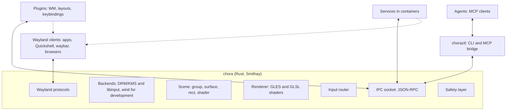
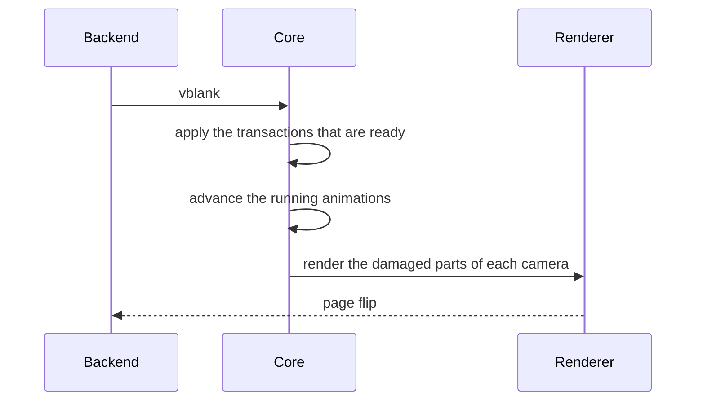

# Architecture

!!! note "Draft"
    This page follows the [Decisions](decisions.md). The first implementation
    will refine it.

## Overview

The core has one language: **commands** and **events** (see [API](api.md)).
Plugins, `choractl`, services and agents all use it. Nothing outside the core
changes the scene in another way.

Plugins are separate processes (D28). A plugin can also be a Wayland client,
for example to draw window decorations as its own surfaces.

## Components

### Core

The compositor binary `chora`. Its tasks, and nothing more:

- Wayland protocol handling and the client lifecycle, through Smithay.
- Backends: DRM/KMS and libinput on real hardware, through libseat. A winit
  window for development inside another compositor.
- The scene, rendered every frame.
- Input routing (see below).
- The IPC socket.
- The safety layer (see below).
- The startup command: `chora -- <command>` runs one command with
  `WAYLAND_DISPLAY` and `CHORA_SOCKET` set. Without a command, the core shows
  a black screen.

The core places popups, subsurfaces and layer surfaces itself, because the
protocols define their position. Smithay's `PopupManager` and `LayerMap` do
this work. Only toplevels wait for a plugin: the core creates a detached
surface node and sends `surface.created`. A plugin decides where the surface
appears, or if it appears at all.

### Scene

The scene is a tree of nodes with stable ids. [API](api.md#nodes) lists the
node properties. The order of the children sets the stacking order. The crate
`chora-scene` holds the scene model (see
[Project structure](project-structure.md)).

### Ownership

Each client names itself when it connects. The owner of a node is a client
name, not a connection, so several `choractl` calls share their nodes.

- Only the owner changes or removes a node.
- A detached surface has no owner. The client that attaches it becomes its
  owner.
- A child under a group does not change the group. The child keeps its own
  owner.
- The removal of a group removes its descendants. Surfaces among them become
  detached.
- When the last connection of a name closes, the core removes the nodes of
  that name. Its surfaces become detached. A client that connects with
  `keep_nodes`, for example `choractl`, keeps its nodes.

### Cameras

All outputs show one logical scene. Each output has a **camera**: a
transform from scene coordinates to output pixels.

- The default camera follows the output layout of `wlr-output-management`.
  An output at position (x, y) with scale s shows the scene area from (x, y)
  with the size of the output divided by s.
- The `camera` command replaces the default, for example to pan or zoom. The
  first client that sets the camera of an output owns it. When the owner
  disconnects, the output gets its default camera back.
- Two outputs side by side get two adjacent default cameras. A window across
  two outputs then needs no special case.

### Renderer

The core uses Smithay's GLES renderer through Smithay's own renderer traits.
Custom texture and pixel shaders give blur, rounded corners, shadows, color
effects and transitions. niri shows what this approach can do. Shaders are
GLSL ES. The core compiles them at runtime and reloads them when they change.
A shader can read other nodes as textures.

Transforms are 4x4 matrices, so 3D effects need no API change. The first
milestones render and test 2D cases only.

Damage tracking keeps the GPU load low. Each shader declares if it is static
or animated, and effects expand the damage area. A fullscreen surface without
effects goes to direct scanout.

### IPC socket

JSON-RPC 2.0, one message per line, on a Unix socket in
`$XDG_RUNTIME_DIR/chora/`. The socket has the name of the Wayland display,
for example `wayland-1.sock`. The core exports the path as `CHORA_SOCKET`.
calloop serves the socket in the event loop of the core, so no thread
handoff is necessary. Events are JSON-RPC notifications on the same
connection.

A plugin can export **methods**, for example `tiling.set_layout`. The core
forwards a method call to the plugin and returns the answer. An agent then
asks the window manager for a change instead of fighting it.

### choractl and the MCP bridge

`choractl` is the CLI for the coordinator. It loads views and starts their
plugins. `choractl mcp` serves the API as MCP tools over stdio. MCP stays out
of the core, so the MCP side can change without a change to the compositor.

## Transactions

A transaction is a batch of commands. The core applies it as one unit.

Some commands need a client round trip. A resize sends a configure event, and
the client must answer with a new buffer. The core therefore holds the
transaction until all affected clients commit, or until a deadline passes.
Then the core shows all changes in the same frame (D22).

## Frame flow

## Input flow

1. libinput sends an event to the core.
2. The safety layer checks its fixed bindings first.
3. The plugins that grabbed the key or the pointer get the event. A plugin
   consumes the event or lets it pass.
4. The focused surface gets each event that no plugin consumed. Pointer
   events go to the topmost node under the cursor that accepts input. The
   inverse of the camera maps the cursor to scene coordinates.

Focus is state in the scene, and plugins set it. The core never sets focus by
itself. The core still implements the protocol mechanisms around focus:
popup grabs, `xdg-activation` requests, `pointer-constraints` and
`input-method`.

## Safety layer

The safety layer is the only built-in behavior (see
[Vision](vision.md#principles)). No plugin and no IPC client can change it.

- **Fixed bindings** (D23). Injected input never triggers them.
- **Emergency reset.** The core disconnects all plugins, removes all effects,
  restores the default cameras and puts all surfaces in a simple grid. This
  grid is the one layout in the core. It is hardcoded, so a broken
  configuration cannot break it.
- **Session lock.** The core enforces `ext-session-lock`. The lock surface is
  above every plugin node.
- **Watchdog.** When frames miss their deadline repeatedly, the core removes
  the effects first and then disconnects the plugins.

## Permissions

Version 1 trusts every client of the same user (D33):

- Unsandboxed Wayland clients get all protocols, as in sway.
  `wp-security-context-v1` hides privileged protocols, for example
  screencopy, from sandboxed clients.
- The IPC methods `input.inject` and `screen.capture` need a **grant** of the
  user for the client name. A grant protects against mistakes of agents. It
  is no barrier against hostile code of the same user.

## Sessions and flavors

- A session file `chora.desktop` starts `chora -- chora-flavor tiling`.
- `chora-flavor <name>` imports `WAYLAND_DISPLAY` and `CHORA_SOCKET` into the
  systemd user manager. Then it starts the target of the flavor. Units of the
  flavor then find the compositor and the IPC socket.
- A derived secureblue image installs the package (D10, D14).
