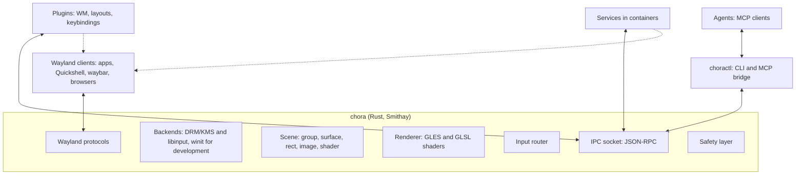
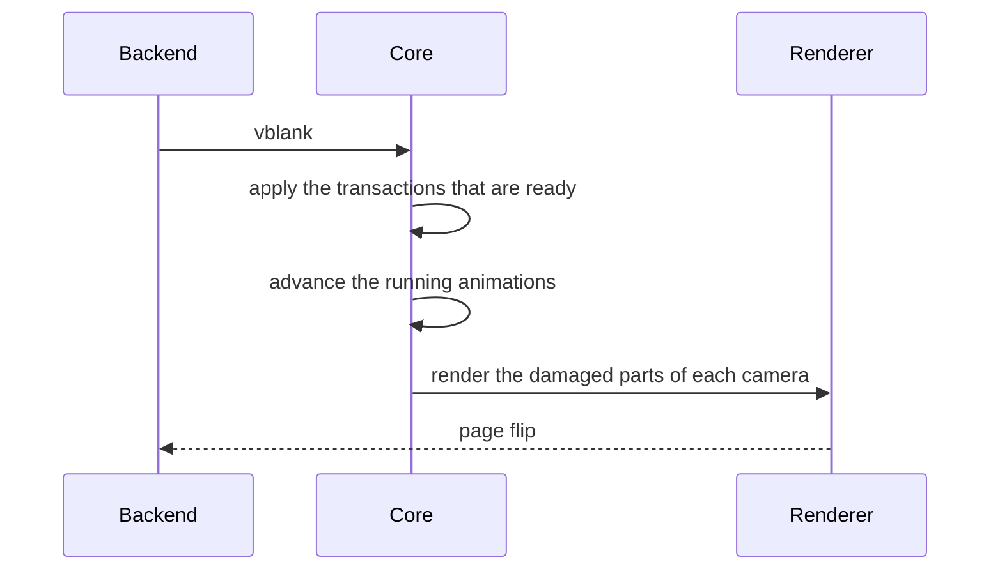

# Architecture

!!! note "Draft"
    This page follows the [Decisions](decisions.md). The first implementation
    will refine it.

## Overview

The core has one language: **commands** and **events** (see [API](api.md)).
Plugins, `choractl`, services and agents all use it. Nothing outside the core
changes the scene in another way.

Plugins are separate processes (D28). A plugin can also be a Wayland client,
for example to draw window decorations as its own surfaces.

## Components

### Core

The compositor binary `chora`. Its tasks, and nothing more:

- Wayland protocol handling and the client lifecycle, through Smithay.
- Backends: DRM/KMS and libinput on real hardware, through libseat. A winit
  window for development inside another compositor. chora uses winit when
  `WAYLAND_DISPLAY` or `DISPLAY` is set, and the hardware otherwise. On
  hardware it draws the cursor of the xcursor theme in `XCURSOR_THEME`.
- The scene, rendered every frame.
- Input routing (see below).
- The IPC socket.
- The safety layer (see below).
- The startup command: `chora -- <command>` runs one command with
  `WAYLAND_DISPLAY` and `CHORA_SOCKET` set. The command does not get the
  variables that reach a host compositor, for example `WAYLAND_SOCKET` and
  `SWAYSOCK`. Without a command, the core shows a black screen.

The core places popups, subsurfaces and layer surfaces itself, because the
protocols define their position. Smithay's `PopupManager` and `LayerMap` do
this work. Layer surfaces, for example panels and launchers, sit in the
coordinates of their output, outside its camera, so a panel stays in place
when a plugin pans the scene. The background and bottom layers are below the
scene, the top and overlay layers above it. A panel reserves an exclusive
zone; the rest of the output is its **work area**. Only toplevels wait for
a plugin: the core creates a detached surface node and sends
`surface.created`. A plugin decides where the surface appears, or if it
appears at all.

Taskbars see the toplevels through `ext-foreign-toplevel-list` and
`wlr-foreign-toplevel-management`. A handle of the second protocol reports
the title, the application id and the outputs that show the surface. Its
states are `activated` for the surface that plugins focused, and `maximized`
and `fullscreen` from the last configure. The core never reports
`minimized`. The requests of a taskbar, `close` included, go to plugins as
`surface.requested`.

### Scene

The scene is a tree of nodes with stable ids. [API](api.md#nodes) lists the
node properties. The order of the children sets the stacking order. The crate
`chora-scene` holds the scene model (see
[Project structure](project-structure.md)).

### Ownership

Each client names itself when it connects. The owner of a node is a client
name, not a connection, so several `choractl` calls share their nodes.

- Only the owner changes or removes a node.
- A detached surface has no owner. The client that attaches it becomes its
  owner.
- A child under a group does not change the group. The child keeps its own
  owner.
- The removal of a group removes its descendants. Surfaces among them become
  detached.
- When the last connection of a name closes, the core removes the nodes of
  that name. Its surfaces become detached. A client that connects with
  `keep_nodes`, for example `choractl`, keeps its nodes.

### Cameras

All outputs show one logical scene. Each output has a **camera**: a
transform from scene coordinates to the logical coordinates of the output.
The output scale then gives the pixels.

- The default camera follows the output layout of `wlr-output-management`.
  An output at position (x, y) shows the scene area from (x, y) with the
  logical size of the output. Scene and layout coordinates then agree.
- The `camera` command replaces the default, for example to pan or zoom. A
  camera is a 2D translation of at most 10^7 and a scale from 1/64 to 64.
  The first client that sets the camera of an output owns it. When the owner
  disconnects, the output gets its default camera back, unless the owner
  keeps its nodes with `keep_nodes`. The reset restores all default cameras.
- Two outputs side by side get two adjacent default cameras. A window across
  two outputs then needs no special case.

### Output configuration

The core implements `wlr-output-management` (D27), so kanshi and wlr-randr
configure the outputs. Every output of the backend is a head of the
protocol, also while it is off. A head can get a mode, a position, a
transform and a scale, or turn off. The core tests a configuration as a
whole before it applies it. If one part fails, the core changes nothing and
answers `failed`. One output must stay on. After a change, the core places
the layer surfaces again and announces the outputs to plugins (see
[API](api.md#ipc-methods)). On winit, the window decides the mode, and the
output cannot turn off. No backend has adaptive sync.

### Renderer

The core uses Smithay's GLES renderer through Smithay's own renderer traits.
Custom texture and pixel shaders give blur, rounded corners, shadows, color
effects and transitions. niri shows what this approach can do. Shaders are
GLSL ES. The core compiles them at runtime and reloads them when they change.
A shader can read other nodes as textures.

Transforms are 4x4 matrices, so 3D effects need no API change. The first
milestones render and test 2D cases only.

Damage tracking keeps the GPU load low. Each shader declares if it is static
or animated, and effects expand the damage area. A fullscreen surface without
effects goes to direct scanout.

### IPC socket

JSON-RPC 2.0, one message per line, on a Unix socket in
`$XDG_RUNTIME_DIR/chora/`. The socket has the name of the Wayland display,
for example `wayland-1.sock`. The core exports the path as `CHORA_SOCKET`.
calloop serves the socket in the event loop of the core, so no thread
handoff is necessary. Events are JSON-RPC notifications on the same
connection.

When a client closes its side of the connection, the core still answers the
requests that arrived, also those of waiting transactions. Then it closes
the connection.

Limits keep a buggy client from exhausting the core:

| Limit | Value | Effect |
|-------|-------|--------------------|
| connections | 128 | the core refuses new connections |
| time until `hello` | 5 s | the core closes the connection |
| line length | 1 MiB | the core closes the connection |
| output buffer of a connection | 8 MiB | the core closes the connection |
| waiting transactions of a connection | 16 | the core rejects the transaction |
| groups and rects in the scene | 16,384 | the core rejects the `create` |
| cameras | 64 | the core rejects the `camera` |

A plugin can export **methods**, for example `tiling.set_layout`. The core
forwards a method call to the plugin and returns the answer. An agent then
asks the window manager for a change instead of fighting it.

### choractl and the MCP bridge

`choractl` is the CLI for the coordinator. It loads views and starts their
plugins. `choractl mcp` serves the API as MCP tools over stdio. MCP stays out
of the core, so the MCP side can change without a change to the compositor.

## Transactions

A transaction is a batch of commands. The core applies it as one unit.

Some commands need a client round trip. A resize sends a configure event, and
the client must answer with a new buffer. The core therefore holds the
transaction until all affected clients commit, or until a deadline of 150 ms
passes. Then the core shows all changes in the same frame (D22). Until
then, a commit blocker holds each answer, so no new buffer shows early, at
the old place.

A surface that misses the deadline is late. No transaction waits for it
until it commits a buffer for its newest configure. A hung client
thus delays the queue once, not once per transaction.

## Frame flow

## Input flow

1. libinput sends an event to the core.
2. The safety layer checks its fixed bindings first.
3. The plugins that grabbed the key or the pointer get the event. A plugin
   consumes the event or lets it pass.
4. The focused surface gets each event that no plugin consumed. Pointer
   events go to the topmost node under the cursor that accepts input. The
   inverse of the camera maps the cursor to scene coordinates.

Plugins set the focus. The core changes it in three cases only:

- The emergency reset focuses the first surface.
- A click on a surface without an owner focuses it.
- A surface that becomes detached loses the focus.

The core still implements the protocol mechanisms around focus: popup
grabs, the keyboard interactivity of `wlr-layer-shell` and
`ext-session-lock`, the locks and confinements of `pointer-constraints`,
and `text-input` with `input-method`. Activation requests of
`xdg-activation` and of taskbars go to plugins as `surface.requested`. A
layer surface that takes the keyboard exclusively, for example a launcher,
has it from its first commit until it goes away, and it ends a popup grab.
A click gives the keyboard to a layer surface that accepts it on demand,
until the next click elsewhere. A popup grabs the input only with the serial
of the press that opened it.

## Safety layer

The safety layer is the only built-in behavior (see
[Vision](vision.md#principles)). No plugin and no IPC client can change it.

- **Fixed bindings** (D23). Injected input never triggers them.
- **SIGUSR1** starts the emergency reset too, for example from a text
  console when the keyboard no longer reaches the compositor.
- **Emergency reset.** The core disconnects all plugins, removes all effects,
  restores the default cameras and puts all surfaces in a simple grid. This
  grid is the one layout in the core. It is hardcoded, so a broken
  configuration cannot break it. The reset also changes the focus (see
  [Input flow](#input-flow)).
- **Session lock.** The core enforces `ext-session-lock`. One client owns
  the lock; other clients cannot lock or unlock while it lives. While the
  session is locked, each output shows only its lock surface, or black.
  Only the lock client gets input; popup and pointer grabs end, and plugin
  grabs pause; a keyboard grab, for example of an input method, ends before
  each key. The core confirms the lock after each output showed a frame
  that it rendered under this lock. When the lock client crashes, the
  session stays locked, and only then can a new lock client take over.
- **Watchdog.** When frames miss their deadline repeatedly, the core removes
  the effects first and then disconnects the plugins.

## Permissions

Version 1 trusts every client of the same user (D33):

- Unsandboxed Wayland clients get all protocols, as in sway. So any client
  can, for example, take the keyboard as an input method, or configure the
  outputs. `wp-security-context-v1` hides privileged protocols, for example
  screencopy, from sandboxed clients.
- The IPC methods `input.inject` and `screen.capture` need a **grant** of the
  user for the client name. A grant protects against mistakes of agents. It
  is no barrier against hostile code of the same user.

## Sessions and flavors

- The session file `chora.desktop` runs `chora-session tiling`. The script
  imports the environment of the login into the systemd user manager and
  starts the user service `chora@tiling.service`. It waits until chora
  ends, and then stops the units of the graphical session.
- Without `XKB_DEFAULT_LAYOUT`, `chora-session` takes the keyboard layout of
  the system from `localectl`.
- `chora@.service` runs `chora -- chora-flavor <name>` as part of
  `graphical-session.target`. It drops `WAYLAND_DISPLAY` and `DISPLAY` that
  an earlier session left in the user manager, which would make chora run
  nested.
- `chora-flavor <name>` imports `WAYLAND_DISPLAY` and `CHORA_SOCKET` into the
  systemd user manager, and `DISPLAY` when `xwayland-satellite` is
  installed. It links the units of the flavor until the next boot,
  tells systemd that chora is ready, and starts the target of the flavor.
  Units of the flavor then find the compositor and the IPC socket. The
  script is not for nested use: the variables would reach the units of the
  host session.
- The tiling flavor starts `chora-tiling`, waybar if it is installed, and
  `xwayland-satellite` on a free X11 display for X11 programs (D26).
- A derived secureblue image installs the package (D10, D14).
