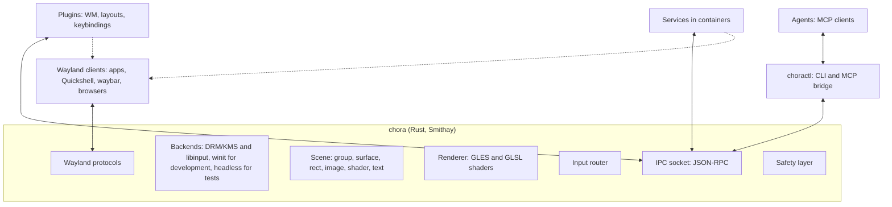
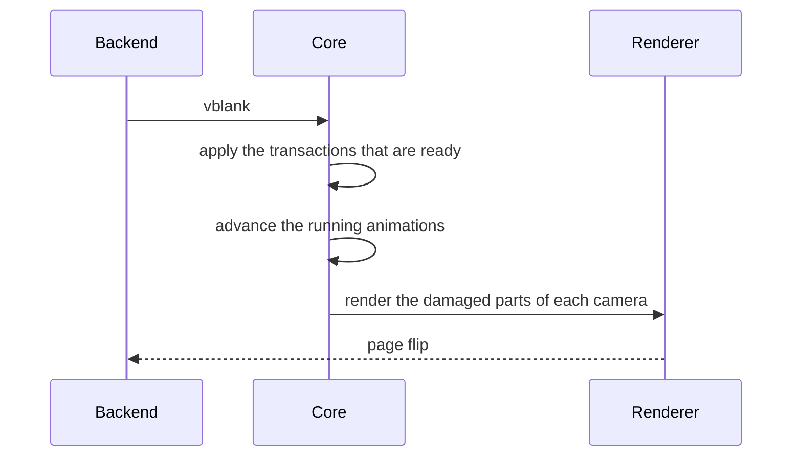

# Architecture

!!! note "Current state"
    This page describes the implementation. The [Roadmap](roadmap.md) lists
    the planned changes, and the [Decisions](decisions.md) give the reasons.

## Overview

The core has one language: **commands** and **events** (see [API](api.md)).
Plugins, `choractl`, services and agents all use it. Nothing outside the core
changes the scene in another way.

Plugins are separate processes (D28). A plugin can also be a Wayland client,
for example to draw window decorations as its own surfaces.

## Components

### Core

The compositor binary `chora`. Its tasks, and nothing more:

- Wayland protocol handling and the client lifecycle, through Smithay.
- Backends: DRM/KMS and libinput on real hardware, through libseat. A winit
  window for development inside another compositor. chora uses winit when
  `WAYLAND_DISPLAY` or `DISPLAY` is set, and the hardware otherwise. On
  hardware it draws the cursor of the xcursor theme in `XCURSOR_THEME`.
  `chora --headless 1280x800` runs on virtual outputs for tests and agents:
  the software renderer of Mesa draws each output into a texture at 60 Hz,
  with damage, and input comes only from `input.inject`. It needs no host
  display, GPU or seat.
- The scene. The core renders it for each output.
- Input routing (see below).
- The IPC socket.
- The safety layer (see below).
- The startup command: `chora -- <command>` runs one command with
  `WAYLAND_DISPLAY` and `CHORA_SOCKET` set. The command does not get the
  variables that reach a host compositor, for example `WAYLAND_SOCKET` and
  `SWAYSOCK`. Without a command, the core shows a black screen.

The core places popups, subsurfaces and layer surfaces itself, because the
protocols define their position. Smithay's `PopupManager` and `LayerMap` do
this work. Layer surfaces, for example panels and launchers, sit in the
coordinates of their output, outside its camera, so a panel stays in place
when a plugin pans the scene. The background and bottom layers are below the
scene, the top and overlay layers above it. A panel reserves an exclusive
zone, and an IPC client reserves space with `output.reserve`; the rest of
the output is its **work area**. Only toplevels wait for
a plugin: the core creates a detached surface node and sends
`surface.created`. A plugin decides where the surface appears, or if it
appears at all.

Taskbars see the toplevels through `ext-foreign-toplevel-list` and
`wlr-foreign-toplevel-management`. A handle of the second protocol reports
the title, the application id and the outputs that show the surface. Its
states are `activated` for the surface that plugins focused, and `maximized`
and `fullscreen` from the last configure. The core never reports
`minimized`. The requests of a taskbar, `close` included, go to plugins as
`surface.requested`.

Screenshot tools and screen sharing capture outputs through
`wlr-screencopy`, for example grim, OBS and `xdg-desktop-portal-wlr` (D37).
A frame offers an shm buffer in XRGB8888. The core renders the output into
it as on screen, without the cursor. Frames of both protocols wait for the
next tick, one refresh later: each tick renders each output or toplevel
once for all its frames, and a client has at most four frames waiting, so
that no client can make the core render more than once per refresh and
source. Newer tools use
`ext-image-copy-capture`, which also captures a toplevel of
`ext-foreign-toplevel-list`; the toplevel shows as `screen.capture` shows
its node. Frames of both protocols fail while the session is locked. The renderer writes into shm buffers in `shm.rs`, which
is the one place with `unsafe` code besides the GL calls in `gl.rs`.

### Scene

The scene is a tree of nodes with stable ids. [API](api.md#nodes) lists the
node properties. The order of the children sets the stacking order. The crate
`chora-scene` holds the scene model (see
[Project structure](project-structure.md)).

### Ownership

Each client names itself when it connects. The owner of a node is a client
name, not a connection, so several `choractl` calls share their nodes.

- Only the owner changes or removes a node.
- A detached surface has no owner. The client that attaches it becomes its
  owner.
- A child under a group does not change the group. The child keeps its own
  owner.
- The removal of a group removes its descendants. Surfaces among them become
  detached.
- When the last connection of a name closes, the core removes the nodes of
  that name. Its surfaces become detached. A client that connects with
  `keep_nodes`, for example `choractl`, keeps its nodes. A client that
  connects with `resume` keeps them for a grace time. A restart within
  the grace time gets them back (see [API](api.md#ipc-methods)).

### Cameras

All outputs show one logical scene. Each output has a **camera**: a
transform from scene coordinates to the logical coordinates of the output.
The output scale then gives the pixels.

- The default camera follows the output layout of `wlr-output-management`.
  An output at position (x, y) shows the scene area from (x, y) with the
  logical size of the output. Scene and layout coordinates then agree.
- The `camera` command replaces the default, for example to pan or zoom. A
  camera is a 2D translation of at most 10^7 and a scale from 1/64 to 64.
  It ignores the z axis, so a uniform scale such as `{"scale": 1.5}` works.
  A camera needs an output that is plugged in or was, so no client
  claims an output before it appears. The first client that sets the
  camera of an output owns it. When the owner
  disconnects, the output gets its default camera back, unless the owner
  keeps its nodes with `keep_nodes`, or with `resume` until the end of its
  grace time. The reset restores all default cameras.
- Two outputs side by side get two adjacent default cameras. A window across
  two outputs then needs no special case.

### Output configuration

The core implements `wlr-output-management` (D27), so kanshi and wlr-randr
configure the outputs. Every output of the backend is a head of the
protocol, also while it is off. A head can get a mode, a position, a
transform and a scale, or turn off. The core tests a configuration as a
whole before it applies it. If one part fails, the core changes nothing and
answers `failed`. One output must stay on. After a change, the core places
the layer surfaces again and announces the outputs to plugins (see
[API](api.md#ipc-methods)). On winit, the window decides the mode, and the
output cannot turn off. Headless outputs accept every change; tests add and
remove them with `output.add` and `output.remove`, as monitors that plug in
and out. No backend has adaptive sync.

### Renderer

The core uses Smithay's GLES renderer through Smithay's own renderer traits.
Custom shaders give blur, rounded corners, shadows, color effects and
transitions. niri shows what this approach can do. An effect is a GLSL ES
fragment shader that a node names; the node becomes a layer, and each
effect is one pass over its texture. The core compiles a shader when a
transaction names it, rejects the transaction on an error, and compiles it
again when the file changes.

Transforms are 4x4 matrices, so 3D effects need no API change. A node with
a size and a mesh, or with a transform that is not a plain 2D translation
and scale, is a **layer**: the core renders it with its descendants into a
texture of its size, and then draws the texture through the mesh, or a
quad, with the full transform of the node and the camera. The vertices go
to the GPU in homogeneous coordinates, so textures map correctly under
perspective. Wobbly windows move the points of a mesh, a magic lamp
animates them, and a desktop cube turns layers in 3D. A layer has no depth
test: the order of the siblings decides what is in front, and a plugin
hides the faces that turn away. Pointer input reaches the nodes of a layer
only where its transform is a plain 2D one.

The core asks each output for a frame once per refresh. It renders only
when the damage tracker of Smithay reports damage. A layer counts as
changed in every frame, so a scene with a layer renders in every frame.
There is no direct scanout. Milestone 0.9 replaces this with a renderer
of chora that renders only on damage (D17, D24).

A text node lays out and draws inside the core. cosmic-text shapes the
text with the system fonts and the fonts of every directory in
`CHORA_FONT_DIRS`. It falls back per character, so CJK and emoji show
without a font choice. A changed prop lays out the node again; a new
output scale rasterizes it again. One cache entry per node holds the
layout size and the raster of each physical scale.

The cost of a frame grows with the number of visible nodes: a node is a
draw call with its own texture, and software GL spends roughly 60 to
140 µs on one. A headless session at 1280x800 on llvmpipe holds about
250 animated nodes at 60 fps; the 0.9 renderer is what moves the
ceiling.

### IPC socket

JSON-RPC 2.0, one message per line, on a Unix socket in
`$XDG_RUNTIME_DIR/chora/`. The socket has the name of the Wayland display,
for example `wayland-1.sock`. The core exports the path as `CHORA_SOCKET`.
calloop serves the socket in the event loop of the core, so no thread
handoff is necessary. Events are JSON-RPC notifications on the same
connection.

When a client closes its side of the connection, the core still answers the
requests that arrived, also those of waiting transactions and
`methods.call`. Then it closes the connection.

Limits keep a buggy client from exhausting the core:

| Limit | Value | Effect |
|-------|-------|--------------------|
| connections | 128, 16 per process, the last 8 for processes without one | the core sends an error line and closes the new connection |
| time until `hello` | 5 s | the core closes the connection |
| line length | 1 MiB | the core answers with an error and closes the connection |
| output buffer of a connection | 8 MiB | the core closes the connection; an answer that does not fit becomes an error |
| waiting transactions of a connection | 16 | the core rejects the transaction |
| nodes other than surfaces | 16,384 | the core rejects the `create` |
| cameras | 64 | the core rejects the `camera` |
| `meta` of a node | 32 keys, 1 KiB per key or value, 4 KiB in all | the core rejects the command |

A plugin can export **methods**, for example `tiling.set_layout`. The core
forwards a method call to the plugin as an event and returns the answer to
the caller. A call without an answer fails after 10 s. An agent then asks
the window manager for a change instead of fighting it (see
[API](api.md#plugin-methods)).

### choractl and the MCP bridge

`choractl` is the CLI for the coordinator. It loads views and starts their
plugins. `choractl mcp` serves the API as MCP tools over stdio, with tools
for whole tasks such as `describe_screen` (see
[API](api.md#mcp-tools)). MCP stays out of the core, so the MCP side can
change without a change to the compositor.

## Transactions

A transaction is a batch of commands. The core applies it as one unit.

Some commands need a client round trip. A resize sends a configure event, and
the client must answer with a new buffer. The core therefore holds the
transaction until all affected clients commit, or until a deadline of 150 ms
passes. Then the core shows all changes in the same frame (D22). Until
then, a commit blocker holds each answer, so no new buffer shows early, at
the old place.

A surface that misses the deadline is late. No transaction waits for it
until it commits a buffer for its newest configure. A hung client
thus delays the queue once, not once per transaction.

A transaction that names an image file waits until a worker thread has
decoded the file, so a large PNG does not stop the event loop. It waits
outside the queue: the transactions of other connections, input and
frames go on, and only the later transactions of the same connection wait
behind it. A file that fails to decode rejects the transaction.

## Frame flow

## Input flow

1. libinput sends an event to the core.
2. The safety layer checks its fixed bindings first.
3. The plugins that grabbed the key or the pointer get the event. A plugin
   consumes the event or lets it pass.
4. The focused surface gets each event that no plugin consumed. Pointer
   events go to the topmost node under the cursor that accepts input. The
   inverse of the camera maps the cursor to scene coordinates.

Plugins set the focus. The core changes it in three cases only:

- The emergency reset focuses the first surface.
- A click on a surface without an owner focuses it.
- A surface that becomes detached, unmaps or goes away loses the focus.

The core still implements the protocol mechanisms around focus: popup
grabs, the keyboard interactivity of `wlr-layer-shell` and
`ext-session-lock`, the locks and confinements of `pointer-constraints`,
and `text-input` with `input-method`. Activation requests of
`xdg-activation` and of taskbars go to plugins as `surface.requested`. A
layer surface that takes the keyboard exclusively, for example a launcher,
has it from its first commit until it goes away, and it ends a popup grab.

A click gives the keyboard to a layer surface that accepts it on demand,
and ends the keyboard focus of a node.
The layer surface keeps it until one of these occurs:

- A click goes elsewhere, or a surface gets the focus.
- Its role goes, or it no longer accepts the keyboard.
- Its output goes.

A popup grabs the input only with the serial of the last press, or of the
last key or button event that its client got. A release counts, so a menu
opens on F10 when the key goes up.

## Safety layer

The safety layer is the only built-in behavior (see
[Vision](vision.md#principles)). No plugin and no IPC client can change it.

- **Fixed bindings** (D23). Injected input never triggers them; see
  [Input injection](api.md#input-injection). They are Ctrl+Alt+BackSpace
  (quit), Ctrl+Alt+Escape (emergency reset), Ctrl+Alt+i (revoke) and
  Ctrl+Alt+F1 to F12 (VT switch).
- **Revoke binding.** Ctrl+Alt+i takes every capability away from every
  client and drops the unused activation tokens. It also ends
  the grabs that need no modifier and disconnects Wayland clients that
  held a grant. The IPC connections stay.
- **Injection mark.** While a client injects input, the core shows a
  small yellow rect of its own next to the pointer. It goes 500 ms after
  the last injected event. No client owns the mark or can remove it.
- **SIGUSR1** starts the emergency reset too, for example from a text
  console when the keyboard no longer reaches the compositor.
- **Last words.** A faulting signal (SIGSEGV, SIGBUS, SIGILL, SIGABRT)
  writes the fault address and a backtrace to stderr before the default
  action ends chora. `tests/last-words.sh` checks it.
- **Emergency reset.** The core disconnects all plugins and ends their
  grace times. It revokes all grants, removes all effects and restores the
  default cameras. It puts all surfaces in a simple grid. This grid is the one layout in the core. It is hardcoded, so a broken
  configuration cannot break it. The reset also changes the focus (see
  [Input flow](#input-flow)).
- **Session lock.** The core enforces `ext-session-lock`. One client owns
  the lock; other clients cannot lock or unlock while it lives. While the
  session is locked, each output shows only its lock surface, or black.
  Only the lock client gets input; popup and pointer grabs end, and plugin
  grabs pause; a keyboard grab, for example of an input method, ends before
  each key. The core confirms the lock after each output showed a frame
  that it rendered under this lock. When the lock client crashes, the
  session stays locked, and only then can a new lock client take over.
- **Watchdog.** When frames take longer to render than a refresh of their
  output for two seconds, the core blames the client whose visible nodes
  cost the most: a node counts 1, a layer and each effect 25 more. It
  removes the effects, the meshes and the shaders of shader nodes of that
  client and sends `effects.dropped` with its name. When frames stay slow
  for two more seconds, the core disconnects that client, at most once a
  minute. It does so only when that client's own load reaches the owner
  budget (D57). `CHORA_OWNER_LOAD_BUDGET` sets that budget, 4000 by
  default. The nodes of a disconnected client go as on any disconnect,
  also those of a client with `keep_nodes` or `resume`, without a grace
  time. When no client alone reaches the budget, the watchdog drops the
  effects of all clients and disconnects none. The watchdog never starts
  the emergency reset; only the binding and SIGUSR1 do.
- **Shader hangs.** A shader that never returns blocks the loop, for
  every backend renders on it. Neither the watchdog, which measures
  between frames, nor SIGUSR1, whose source the loop dispatches, can
  end it: on llvmpipe the core hangs, on a GPU until the driver resets
  the context. The way out is to kill the core from another TTY or
  over SSH.

## Permissions

chora trusts every client of the same user. One gap comes with the Rust
Wayland backend: a message whose size is not a multiple of four leaves
that connection deaf instead of answered with a protocol error, and the
core has no frame of its own to reject. Correct clients send no such
message. The caps of the IPC socket (16 connections per process, 128
in total) and of the client sockets (16) bound the harm; the main
Wayland socket has no cap. Milestone 0.7 replaces the
grants with client sockets that fix the name and the capabilities of a
client (D33, D40). In: a client socket fixes the name of
its clients, and a Wayland socket next to it offers the privileged
protocols only with grants. Only the admin socket of `choractl` changes
grants and makes client sockets (see [API](api.md#client-sockets)).

- Unsandboxed Wayland clients get all protocols, as in sway. So any client
  can, for example, take the keyboard as an input method, or configure the
  outputs.
- A sandbox such as Flatpak connects its apps through a socket of
  `wp-security-context-v1`. Those clients do not see the privileged
  protocols: the layer shell, the session lock, the input method, both
  foreign toplevel protocols, output management, both screencopy protocols
  with their sources, and the security context manager itself.
- The IPC methods `input.inject` and `screen.capture` need a **grant**
  of the user for the client name: `choractl grant NAME CAPABILITY`.
  A grant protects against mistakes of agents. It is no barrier against
  hostile code of the same user. The emergency reset revokes all grants.
- `screen.capture` and `input.inject` fail while the session is locked.
- The core starts no program except its own startup command (D42).
  `choractl run` starts programs outside it, and systemd units keep
  plugins running.
- A connection of a client socket acts only on its own nodes and on the
  windows of its `wayland.sock`. It sets no camera and puts no node
  under `screen:*`. It takes the keyboard with `focus_node` only after a
  press of the user on it (see [API](api.md#client-sockets)).

## Sessions and flavors

- The session file `chora.desktop` runs `chora-session tiling`. The script
  imports the environment of the login into the systemd user manager and
  starts the user service `chora@tiling.service`. It waits until chora
  ends, and then stops the units of the graphical session.
- Without `XKB_DEFAULT_LAYOUT`, `chora-session` takes the keyboard layout of
  the system from `localectl`.
- `chora@.service` runs `chora -- chora-flavor <name>` as part of
  `graphical-session.target`. It drops `WAYLAND_DISPLAY` and `DISPLAY` that
  another session left in the user manager, which would make chora run
  nested.
- `chora-flavor <name>` imports `WAYLAND_DISPLAY` and `CHORA_SOCKET` into the
  systemd user manager, and `DISPLAY` when `xwayland-satellite` is
  installed. It links the units of the flavor until the next boot,
  tells systemd that chora is ready, and starts the target of the flavor.
  Units of the flavor then find the compositor and the IPC socket. The
  script is not for nested use: the variables would reach the units of the
  host session.
- The tiling flavor starts `chora-tiling`, waybar if it is installed, and
  `xwayland-satellite` on a free X11 display for X11 programs (D26).
- A derived secureblue image installs the package (D10, D14).
